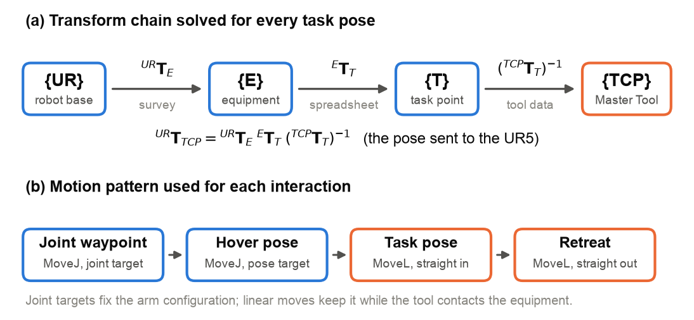
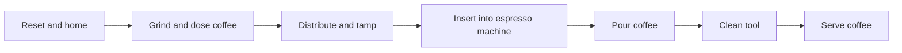

## Overview

This project programs a Universal Robots UR5 arm to make a coffee autonomously. Written in Python using the RoboDK API, the program works through a 22-step sequence across a coffee grinder, espresso machine, scales and supporting fixtures, swapping between interchangeable tools as it goes. The program was developed in RoboDK simulation, then tested and refined on the physical robot. Its main features include:
- Locating each fixture from surveyed points
- Defining every task in the fixture's own local frame
- Closed-loop coffee dosing using live scale readings over Modbus
- Automatic tool changes between the grinder, espresso machine and cup tools

The main program is `group210.py`. It uses a RoboDK tool library supplied with the course, which is not included here.

## Table of Contents

- [Overview](#overview)
- [Table of Contents](#table-of-contents)
- [Program Flow](#program-flow)
- [Coordinate Frames](#coordinate-frames)
- [Robot Motion](#robot-motion)
- [Dosing](#dosing)

## Program Flow
The program runs each stage of making a coffee as its own function, called in order from `main()`.

## Coordinate Frames
Each piece of equipment has its own local coordinate frame. The position and rotation of each frame relative to the robot base were calculated from surveyed points known in both frames. Task points such as buttons, levers and tool seats were then defined locally and converted into robot commands through chains of homogeneous transformation matrices. This kept the code modular, as re-surveying a fixture only changes one transform.

## Robot Motion
Joint moves (MoveJ) were used to travel between tasks and set the arm's configuration, then straight-line moves (MoveL) were used for the final approach to each machine. Circular moves (MoveC) turned the distribution tool's rotor, split into half-circles to avoid winding up the wrist.

## Dosing
The scales communicate over Modbus. During dosing, the program reads the live weight and pulls the grinder lever in full strokes, then smaller strokes as it approaches the 20 g target.
